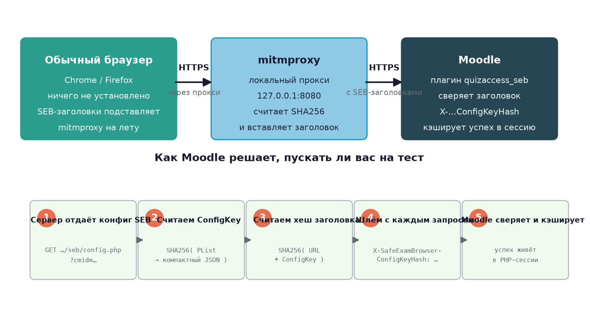
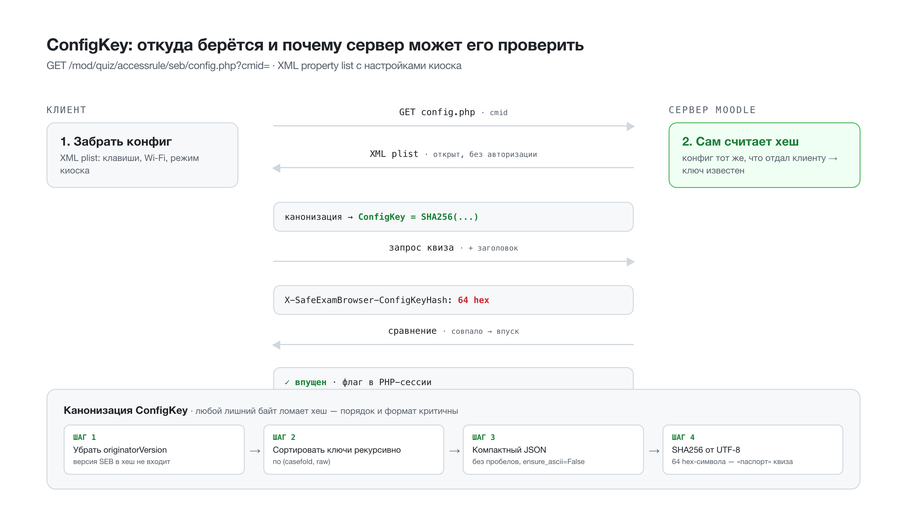
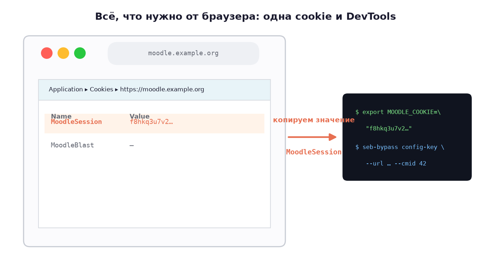
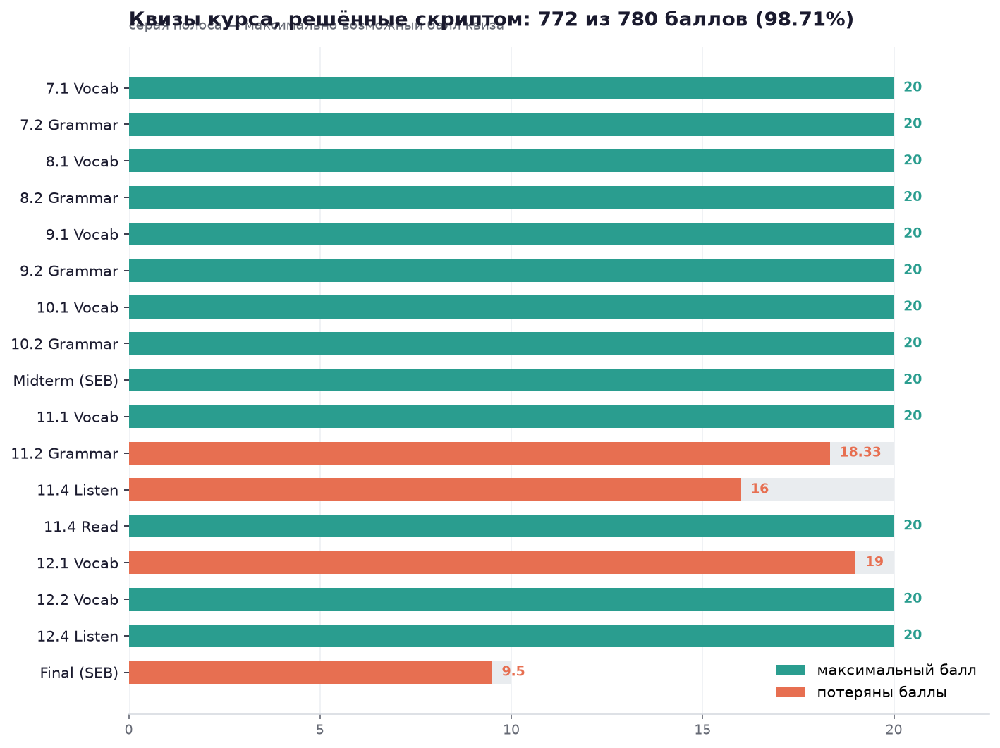

# Как я сдавал английский через самописный бэкдор в Safe Exam Browser

> Лонгрид о том, как Moodle проверяет «тот ли это браузер», почему проверка держится на одном заголовке и как обычный Chrome убедил сервер, что он Safe Exam Browser. Внутри: SHA256, mitmproxy, немного боли с кроссвордами и график результатов.



## Дано

Университетский курс английского в Moodle. Между блоками с лекциями висят квизы на баллы, а два главных (Midterm и Final) открыты только через Safe Exam Browser: проприетарный киоск-браузер, который блокирует всё, кроме страницы теста. Поставил, запустил, сдал. Но у такого подхода есть минусы: SEB работает не на каждой машине, живёт своей жизнью, а главное, когда решаешь тесты скриптом, SEB просто мешает.

Задача сформулировалась сама: **решать все тесты из обычного браузера, чтобы сервер был уверен, что это SEB**. Без виртуалок, без admin-прав, без патченных бинарников.

## Первая разведка

Moodle для SEB-квизов ставит плагин `quizaccess_seb`. Если открыть страницу теста из обычного браузера, Moodle радостно сообщает: «This quiz has been configured to use the Safe Exam Browser». Но до этой страницы тест долетает HTTP-запрос, а значит, у проверки есть какой-то механизм в заголовках.

Открыл DevTools, повторил запрос с нужными заголовками, начал перебирать. Быстро нашлась структура: сервер смотрит на заголовок `X-SafeExamBrowser-ConfigKeyHash`. Если он правильный, запрос пропускают. Если нет, `"error": "Invalid config key"`.

Сам заголовок вычисляется как:

```
SHA256( URL_без_query_string + ConfigKey )
```

Здесь два вопроса. Откуда берётся `ConfigKey` и почему сервер может его проверить, если клиент его сам придумал?

## Откуда берётся ConfigKey

Оказалось, у каждого SEB-квиза в Moodle есть открытый эндпоинт:

```
GET /mod/quiz/accessrule/seb/config.php?cmid=<id>
```

Он отдаёт XML property list с настройками SEB для этого теста: какие клавиши запрещены, разрешён ли Wi-Fi, куда запрещено переключаться, и так далее. Никакой магии, обычный конфиг.



ConfigKey это SHA256 от этого конфига, но не «как есть», а после канонизации. Вот весь алгоритм (из `seb_bypass/configkey.py`):

```python
def _sort_recursively(obj):
    """Sort every dict in the structure by (casefolded key, raw key)."""
    if isinstance(obj, dict):
        return {
            k: _sort_recursively(v)
            for k, v in sorted(obj.items(), key=lambda kv: (kv[0].casefold(), kv[0]))
        }
    if isinstance(obj, list):
        return [_sort_recursively(item) for item in obj]
    return obj

def compute_config_key(seb_config: bytes) -> str:
    plist = plistlib.loads(seb_config)
    if not isinstance(plist, dict):
        raise ValueError("SEB config root must be a <dict> plist")

    # 1. SEB strips its own version marker before hashing.
    plist.pop("originatorVersion", None)

    # 2-3. Canonicalise and serialize to compact JSON.
    canonical = json.dumps(
        _sort_recursively(plist),
        separators=(",", ":"),
        ensure_ascii=False,
    )

    # 4. Hash.
    return hashlib.sha256(canonical.encode("utf-8")).hexdigest()
```

Четыре шага, и каждый важен:

1. **Убрать `originatorVersion`.** SEB вписывает в конфиг свою версию, но в хеш она не входит. Плагин её выбрасывает перед подсчётом. Если забыть, хеш всегда будет неверным.
2. **Рекурсивно отсортировать ключи** в каждом словаре, без учёта регистра (`casefold`). Порядок ключей не должен влиять на хеш.
3. **Сериализовать в компактный JSON:** без пробелов, `ensure_ascii=False`, разделители `(',', ':')`. Любая лишняя запятая или `\u`-экранирование сломает хеш.
4. **SHA256 от полученной строки.** Это и есть ConfigKey: 64 hex-символа, «паспорт» квиза.

Сервер может проверить хеш, потому что ConfigKey он вычисляет у себя по тому же конфигу, который сам же отдал. Клиент доказывает, что прочитал конфиг и правильно его канонизировал.

Ключ канонизации я сверил с реальным SEB: собрал конфиги с разных квизов, посчитал хеши, сравнил с тем, что присылает настоящий SEB. Совпало. Затем покрыл это тестами, включая кейс, когда два ключа отличаются только регистром: `{'a': 1, 'A': 2}` сортируется детерминированно, по паре `(casefold, raw)`.

## Почему Moodle «запоминает» вас

Самое приятное открытие было дальше. После первого успешного захода на страницу теста Moodle сохраняет факт проверки в PHP-сессию:

```php
$SESSION->quizaccess_seb_access[$cmid] = true;
```

А дальше сессия с валидным флагом пропускается без проверки заголовков. То есть SEB-заголовок нужен один раз, чтобы «отметиться», потом можно ходить по тесту как обычный браузер. Это резко упрощает жизнь: перехватывать нужно только вход на квиз, а не каждый запрос.



## Прокси, который делает вид, что вы SEB

Было два пути:

1. **Headless-клиент на Python:** логин, `sesskey`, парсинг вопросов, отправка ответов. Всё внутри скрипта.
2. **Прозрачный прокси:** сидишь в обычном Chrome, кликаешь руками, а между браузером и Moodle стоит mitmproxy, который подставляет SEB-заголовки в нужные запросы.

Реализовал оба, потому что они закрывают разные сценарии. Клиент удобен для автоматизации («реши все квизы»), прокси удобен для живого человека, который хочет кликать мышкой и видеть тест глазами.

Прокси это самый короткий файл проекта, `mitm_addon.py`. Логика: перехватить ответ `config.php`, посчитать ConfigKey, запомнить по `cmid`. Потом на каждый запрос к хосту Moodle добавить два заголовка:

```python
flow.request.headers["X-SafeExamBrowser-ConfigKeyHash"] = digest
ua = flow.request.headers.get("User-Agent", "")
if "SafeExamBrowser" not in ua:
    flow.request.headers["User-Agent"] = ua + " SafeExamBrowser/3.7.0"
```

Запуск для пользователя выглядит так:

```bash
mitmdump -s seb_bypass/mitm_addon.py --set seb_url=https://moodle.example.org
```

Плюс установить mitmproxy-сертификат, чтобы HTTPS расшифровывался. Дальше в системных настройках прокси ставишь `127.0.0.1:8080`, открываешь Moodle, заходишь на тест. Сервер видит SEB.

## Грабли, на которые наступил

**Кроссворд.** Один из квизов был в формате «кроссворд»: картинка с сеткой, буквы вписываются по клеткам. HTML-парсинг бесполезен, надо смотреть глазами. Помогли PIL (нарезать картинку на сектора) и Tesseract OCR (распознать вписанные слова). Одно слово «techno» упорно не находилось, пришлось пересматривать клетки вручную. Три попытки, но 20/20 в итоге.

**Контроль порядка вопросов при повторе.** Самая коварная ловушка была в другом. При пересдаче квиза Moodle создаёт новый attempt и может сменить внутренний идентификатор `qubaid` и перемешать порядок вопросов. Первый раз я на этом погорел: переиспользовал payload с прошлого захода, ответы поехали не на те вопросы, попытка ушла в 0/20.

Правильный подход: **перед каждым POST перечитывать страницу попытки**, вытащить актуальный `qubaid`, `sequencecheck` для каждого слота и сопоставлять ответы с вариантами по тексту, а не по индексам:

```python
# q<qubaid>:<slot>_:sequencecheck обязателен для каждого слота,
# и он меняется между попытками
seq_key = f"q{qubaid}:{slot}_:sequencecheck"
flagged = f"q{qubaid}:{slot}_:flagged"
```

**Аудио в listening.** Аудиофайлы лежат в медиатеке Moodle. Отдельный интересный кейс: прослушать, законспектировать, ответить. Скрипту это недоступно, слушал сам, но ответы потом отправлялись тем же клиентом.

## Результат



772 балла из 780, это 98.71% курса. В таблице лидеров: 22-е место из 372 студентов, при том, что остальные шли в основном через SEB и руками. Потери: один квиз по лексике (19/20, двусмысленное определение), грамматика 18.33/20 (спорный вопрос с «spill»), listening 16/20 (аудио, где скрипту делать нечего).

## Что в проекте

Репозиторий: [s1rne/moodle-seb-bypass](https://github.com/s1rne/moodle-seb-bypass). Лицензия CC BY-NC-SA 4.0: пользуйтесь, форкайте, но не продавайте и не закрывайте исходники форков.

Структура минимальная:

```
seb_bypass/
  configkey.py   # SHA256-канонизация PList -> ConfigKey
  client.py      # headless-клиент Moodle: логин, вопросы, отправка
  mitm_addon.py  # аддон для mitmproxy: перехват и подмена заголовков
  cli.py         # seb-bypass config-key / check
tests/           # unit-тесты, включая реальные конфиги SEB
scripts/         # setup_mac_linux.sh и setup_windows.bat
```

Быстрый старт:

```bash
git clone https://github.com/s1rne/moodle-seb-bypass
cd moodle-seb-bypass
python -m pip install -e .
seb-bypass config-key --url https://moodle.example.org --cmid 42 --cookie <MoodleSession>
```

CI гоняет тесты на Ubuntu, macOS и Windows, Python 3.9, 3.11, 3.12. Проверено и на Apple Silicon, и на Intel, и на Windows-железе.

## Выводы

Протокол проверки SEB оказался простым: один хеш из открытого конфига и один заголовок. Вся «защита» держится на предположении, что клиент честно посчитает SHA256 и признается, что он SEB. Проверка подлинности, которую может выполнить сам клиент, всегда будет перехватываемой: вопрос лишь в том, сколько усилий потратил тот, кто хочет её обойти.

Moodle кэширует успешную проверку в сессии, так что после первого захода даже перехватывать больше ничего не нужно. Это хорошо для производительности и плохо для защищённости: заголовок нужен один раз.

Если захотите повторить: главное не патчить бинарники, а читать протокол. Весь SEB-хендшейк укладывается в один экран кода, а остальное уже детали.
